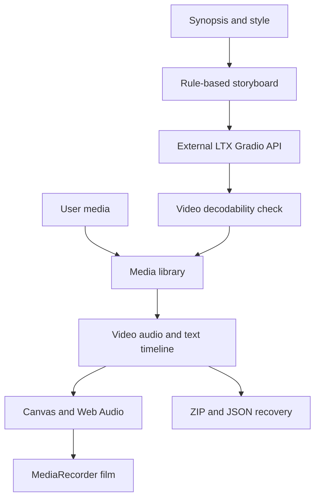

# META-STUDIO PRO V6 — Studio Niko Design

**Browser-based filmmaking · Generative video connectors · Editing and media recovery**

  

[Application GitHub Pages (disponibilité non vérifiée)](https://nikoju1977.github.io/ia-studio-cine/) · [Sauvegarde des médias](SAUVEGARDE_MEDIA.md) · [English overview](#english-overview) · [Portfolio](https://github.com/Nikoju1977)

**STUDIO NIKO DESIGN** · Build smart. Stay lightweight. Create without limits.

> [Insérer ici un GIF de démonstration / Insert demo GIF here]

## Fiabilisation du 25 novembre 2026 — rendu et connecteurs LTX

[Correctif rendu](https://github.com/Nikoju1977/ia-studio-cine/commit/fe85546690a0090c942fe569e687e1c0f7fd4201) · [LTX-2.3](https://github.com/Nikoju1977/ia-studio-cine/commit/28ad3fb411e0d1b5402e4b259e014f407a511e29) · [LTX 13B](https://github.com/Nikoju1977/ia-studio-cine/commit/c7031929f0b078d20fef8d9339b2db4410e4caa1).

- Validation du temps, des identifiants et des sources de la timeline avant rendu ; plafond interne de 200 clips et de 192 Mio de données encodées cumulées. Le plafond n'est pas une mesure de la mémoire totale du navigateur.
- Arrêt explicite si l'onglet est masqué ou l'horloge de rendu / l'audio suspendus, annulation du chargement média, nettoyage des ressources, format basé sur le MIME effectif du MediaRecorder.
- LTX : traitement des séparateurs CRLF fragmentés et du dernier paquet SSE sans séparateur final ; fermeture du flux, délai local maximal de dix minutes, validation du prompt et du format d'image. Pas de relance automatique du POST, pas de garantie d'annulation distante, ni de gratuité illimitée.
- 14 assertions de validation timeline et 7 assertions sur le parseur SSE exécutées avec succès lors de la rédaction. Tests de régression ajoutés dans les deux fichiers de tests ; CI de cette révision non vérifiée. Sources des trois modules relues après publication.
- Aucune génération GPU ni aucun rendu vidéo réel effectué pendant cette intervention. Timeline, fonctions de montage, effets, export et fournisseurs historiques conservés. Aucun nouveau moteur, aucune nouvelle dépense ni validation de production revendiqués.

## Pourquoi ce projet ?

Rendre accessible une chaîne de réalisation allant de l'idée au montage exportable, sans confondre les modèles vidéo distants avec le traitement audiovisuel local. La frugalité vient d'une interface JavaScript native et de l'utilisation des capacités du navigateur ; l'inférence vidéo reste externalisée.

## Moteurs, formats et performances — inspection des sources

| Composant | Implémentation observée |
| --- | --- |
| [meta-studio-auto-film.js](meta-studio-auto-film.js) | Storyboard déterministe (3, 4 ou 6 plans, 2–8 secondes demandées par plan), prompts de continuité et enchaînement séquentiel. La dernière image peut être réutilisée comme référence lorsque le média est récupérable. |
| [meta-studio-pro-video.js](meta-studio-pro-video.js) | Connecteur LTX-2.3 via Gradio : découverte des endpoints, upload éventuel, suivi SSE et extraction de l'URL vidéo. |
| [meta-studio-free-video.js](meta-studio-free-video.js) | Connecteur LTX 13B via Gradio ; les paramètres de durée sont bornés côté client. |
| [meta-studio-v5-core.js](meta-studio-v5-core.js) | Connecteur Agnes, clés en mémoire, gestion d'état, contrôles d'URL et résultats. |
| [meta-studio-v5-media.js](meta-studio-v5-media.js) | Timeline vidéo/audio/titres, timecode nominal 24 i/s, outils Canvas et exports d'échange. |
| [meta-studio-v5-render.js](meta-studio-v5-render.js) | Canvas.captureStream, mixage Web Audio, MediaRecorder, horloge temps réel. |
| [meta-studio-recovery.js](meta-studio-recovery.js) | Deux générations de métadonnées de montage, limite de 1 400 000 caractères de JSON environ, sans médias binaires. |

### Encodage et performances

Le moteur sélectionne le premier MIME accepté par `MediaRecorder.isTypeSupported` parmi MP4 avec AVC/AAC (`avc1.42E01E,mp4a.40.2`), MP4 générique, WebM VP9/Opus, WebM VP8/Opus et WebM générique. Il ne contient pas un codec propriétaire ; le navigateur choisit l'encodeur effectif.

| Paramètre | Valeur programmée, non mesurée |
| --- | --- |
| Rendu HD / Full HD | 1280×720 / 1920×1080 |
| Cadence nominale | 24 i/s |
| Débit vidéo demandé | 6 Mbit/s / 12 Mbit/s |
| Durée maximale | 900 s |

Le débit effectif, la cadence constante, le profil AVC réellement produit, la synchronisation A/V, le temps d'encodage et les performances matérielles ne sont pas garantis. Le contrôle des clips générés par `verifyVideo` vérifie les métadonnées décodées (dimensions et durée), pas chaque image ni la qualité artistique. Le chaînage d'images ne garantit pas la conservation d'un personnage. L'annulation locale n'établit pas l'annulation du calcul distant ou de la facturation.

### Frontières de confidentialité et dépendances

Les prompts et images de référence partent vers les services externes sélectionnés. Les clés Agnes restent en mémoire selon le code inspecté ; les métadonnées et prompts de récupération sont stockés en clair. Les archives ZIP peuvent contenir des médias personnels et ne sont pas chiffrées par le projet. La dépendance ZIP chargée depuis CDN est réelle ; pas de revendication « zéro dépendance ». Les URLs temporaires et les restrictions CORS limitent la récupération. Les licences et conditions des modèles, médias et bibliothèques tiers sont distinctes de la notice du dépôt.

Aucun benchmark, rendu complet, génération LTX/Agnes réelle ou contrôle de disponibilité fournisseur n'a été exécuté pour cette mise à jour. Les quotas et tarifs figurant dans les notes historiques ne sont pas des garanties actuelles.

## Architecture technique

| Source | Responsabilité |
| --- | --- |
| [meta-studio-auto-film.js](meta-studio-auto-film.js) | Storyboard déterministe, enchaînement des plans et contrôle de décodabilité |
| [meta-studio-pro-video.js](meta-studio-pro-video.js) | Découverte du protocole Gradio et suivi LTX |
| [meta-studio-free-video.js](meta-studio-free-video.js) | Connecteur LTX de secours |
| [meta-studio-v5-render.js](meta-studio-v5-render.js) | Assemblage local et capture audiovisuelle |
| [meta-studio-recovery.js](meta-studio-recovery.js) | Récupération des références de projet |

**Périmètre vérifié par inspection :** les connecteurs soumettent des demandes à des moteurs externes ; les modèles vidéo ne sont pas embarqués dans le navigateur. Le montage est un traitement local réel, distinct de la génération distante. La disponibilité, les quotas, les prix et les modèles des services tiers ne sont pas revérifiés ici.

Studio cinéma dans le navigateur : réalisation autonome, connecteurs de génération vidéo IA LTX-2.3 (22B) et LTX 13B sur Hugging Face ZeroGPU, storyboarding, médiathèque, timeline, traitement d’image et audio, exports de projets. Interface française, HTML/CSS/JavaScript natifs.

**Page principale :** [index.html](./index.html) — **Version :** 6.0.

## Quickstart / Démarrage rapide
1. Lancer un serveur statique dans ce dossier : python3 -m http.server 8000
2. Ouvrir http://localhost:8000
3. Dans **Réalisateur autonome V6**, saisir un synopsis, choisir le style et cliquer sur « PRODUIRE LE FILM DE A À Z ». Le mode par défaut utilise LTX-2.3 via un Space externe, sous réserve de ses conditions et de sa disponibilité. Pour le mode classique, sélectionnez Production → Vidéo ; pour l'image/chat, une clé Agnes reste nécessaire.
4. Ajouter les résultats à la timeline, créer des overlays, appliquer les looks et exporter.

Les modules JavaScript nécessitent HTTP/HTTPS. Sur GitHub Pages, la génération gratuite passe directement par les API publiques Gradio des Spaces Lightricks ; le navigateur et le Space doivent autoriser les appels CORS. En cas de refus, ouvrir le Space officiel directement. Les appels Agnes peuvent eux aussi être bloqués par CORS.

## Fonctionnalités

- **LTX 13B (moteur de secours)** : véritable modèle de génération texte→vidéo ou image→vidéo (LTX-Video 13B Distilled), calculé sur les GPU partagés Hugging Face ZeroGPU, selon les conditions du Space externe, non revérifiées ici. L’API Gradio accepte le prompt, téléverse éventuellement une image, suit la tâche par événements et ajoute **uniquement le vrai fichier vidéo** renvoyé à la médiathèque. Aucun résultat simulé ni moteur payant automatique.

- **Agnes :** chat et image via Agnes 2.5 ; vidéo via Video 2.5 Flash (720p) ou Video 2.5 (facturation possible avec accord explicite). Génération text-to-video et animation depuis une image importée avec mode keyframe, suivi par video_id, annulation locale et respect du Retry-After lors d’un code 429. Les créations vidéo POST ne sont jamais retentées automatiquement. Plusieurs clés peuvent être chargées en mémoire, sans garantie de quota supplémentaire.
- **Médiathèque :** imports locaux image et vidéo, previews, ajout à la timeline.
- **Montage :** trois pistes vidéo/audio/texte, déplacements, coupes conservant les in-points, suppression, scrub et prévisualisation à 24 i/s.
- **Color Lab :** six looks et lift, gamma, gain, saturation (Canvas, 8 bits).
- **Outils locaux :** masque de luminance, carte de luminance et redimensionnement x2, clairement distingués d’une véritable segmentation/profondeur/super-résolution par IA.
- **Audio :** ajout de sons, balance d’écoute des pistes, niveau dBFS RMS d’un fichier et synthèse vocale système.
- **Agent local :** commandes textuelles déterministes (pas un LLM autonome).
- **Export :** véritable film assemblé HD/Full HD avec titres et mixage des pistes audio grâce à Canvas, Web Audio et MediaRecorder (WebM/MP4 selon navigateur), plus médias sources, ZIP, projet JSON, EDL, OTIO JSON et FCPXML référentiel.

## Limitations honnêtes
- **ZeroGPU n’est pas illimité** : l’accès gratuit dispose d’un quota de temps de GPU quotidien (documentation Hugging Face : 2 minutes en anonyme, 5 minutes avec compte gratuit), de files d’attente et de restrictions éventuelles. Les clips peuvent échouer et ne sont pas garantis. Les paramètres proposés par le modèle sont approximativement de 0,3 à 8,5 s. Le backend et les capacités du Space tiers peuvent changer.
- **Test réel non confirmé à ce jour :** le code est enregistré sur GitHub et validé statiquement par des tests de protocole simulés, mais aucune génération IA de bout en bout n’a été confirmée depuis un navigateur Android avec réception d’un MP4. Un échec CORS ou un quota saturé reste possible.
- La génération Agnes nécessite une clé et une connexion réseau, et n’a pas été testée ici avec une clé réelle. Les quotas et tarifs restent ceux du fournisseur.
- Les URL blob: locales expirent après fermeture du navigateur ; les URL CDN distantes peuvent expirer. L’export ZIP dépend de la disponibilité et du CORS des médias.
- Le **rendu vidéo** s'effectue en temps réel dans le navigateur, jusqu'à 15 min par export. Le format est **WebM ou MP4 selon MediaRecorder** ; l'exactitude image par image et la lecture de tous les codecs ne sont pas garanties. Pas de ProRes/DNxHR, pas de rendu serveur. Les sources distantes sans autorisation CORS ne peuvent pas être capturées.
- **Pas d’ACES officiel** : looks RGB natifs uniquement.
- **Pas d’EBU R128 / LUFS conforme** : le compteur est un RMS dBFS.
- **Pas de SlimSAM, Depth Anything ou Swin2SR installés** : les outils locaux sont algorithmiques.
- Les exports de montage décrivent structure et liens médias, et peuvent nécessiter un relink dans le logiciel cible.

## Sécurité
Le chemin de configuration inspecté conserve les clés API en mémoire, sans persistance volontaire dans les exports ou le stockage navigateur. Les clés sont conservées seulement dans la mémoire de l’onglet. Elles sont néanmoins visibles par le navigateur et transmises directement au fournisseur ; pour une protection renforcée, un proxy serveur authentifié est nécessaire.

## Validation
La CI GitHub teste la syntaxe de meta-studio-v5-core.js, meta-studio-v5-media.js et meta-studio-v5-render.js avec node --check, puis les identifiants HTML, les dépendances et l’absence de stockage de clés grâce à node verify-v5.mjs. Cela ne remplace pas des tests de bout en bout avec Agnes ou un logiciel de montage.

## Modules historiques conservés
Le dépôt conserve niko-genesis/ (NIKO STUDIO — CINÉ GENESIS), motionlibre/, wangp_bridge.html et leur historique. La page principale de l’ancien AI STUDIO PRO a été remplacée ; les autres modules ne sont pas supprimés.

**Studio Niko Design — Nicolas Julienne.**

## Rendu film V5.1

1. Importez des plans dans la médiathèque ; ajoutez-les à V1. Importez la bande-son dans A1 et insérez les textes dans TEXTE.
2. Ouvrez **Exports & projets** puis **Film monté** et choisissez HD ou Full HD.
3. Lancez le rendu sans verrouiller l’écran, laissez l’onglet actif jusqu’au téléchargement. Annuler interrompt l'encodage et écarte le fichier partiel.
4. Sur appareils mobiles, privilégiez 720p et des vidéos MP4/WebM compatibles ; vérifiez toujours le fichier final. Les sources distantes Agnes doivent autoriser CORS ou être réimportées localement.

Ce rendu utilise les capacités MediaRecorder/Canvas/Web Audio du navigateur. Il ne certifie ni la cadence constante, ni l'étalonnage broadcast, ni la fidélité des effets. Les looks Color Lab appliqués à des images séparées doivent être ajoutés à la médiathèque avant export.

## Correctif V5.2 : erreur Agnes HTTP 500 et mobile

- La capture Android du 12 novembre 2026 montrait un HTTP 500 : « Model agnes-video-v2.0 is temporarily unavailable ».
- Passage du protocole vidéo V2.0 hérité à Video 2.5 : `model`, `mode`, `seconds` (4 à 12 s), `size: "720P"`, `aspect_ratio`, `n: 1` et `model_name` au suivi GET.
- Modèle Video 2.5 Flash par défaut. L'option Video 2.5 exige une confirmation explicite pour la facturation potentielle. Aucun basculement automatique vers un modèle payant.
- Une image de médiathèque peut être choisie volontairement comme première image. L'image locale est envoyée via Data URI Base64 après sélection, dans la limite de 4,5 Mo. Une URL HTTPS reste transmise comme référence : sa disponibilité côté Agnes n'est pas garantie.
- En HTTP 500/503, message français explicite, identifiant de support conservé lorsqu'il existe, image et prompt préservés, et aucune simulation de succès.
- Pour éviter les doubles tâches et une facturation imprévue, les appels de création POST ne sont pas relancés automatiquement. Les consultations GET peuvent être reprises après une pause bornée.
- Navigation mobile en grille 2 colonnes pour que les sept modules soient toujours visibles sans barre horizontale décalée.
- **Vérification restant à faire :** création et encodage réels avec une clé Agnes valide, ainsi qu'un test navigateur Android complet ; le statut de déploiement ne prouve pas leur réussite.

Référence de protocole : https://github.com/AgnesAI-Labs/skills/blob/main/agnes-ai-models/references/model_catalog.md

## V5.3 — Génération IA réellement gratuite (ZeroGPU)

- Moteur par défaut : [Space Lightricks LTX Video Fast](https://huggingface.co/spaces/Lightricks/ltx-video-distilled) (code du Space : [app.py](https://huggingface.co/spaces/Lightricks/ltx-video-distilled/blob/main/app.py)).
- Appels POST /gradio_api/call/text_to_video ou /image_to_video, lecture du résultat via les événements de la file Gradio. Téléversement /gradio_api/upload pour les images de référence.
- Les quotas, l’accessibilité du Space, le CORS et la génération finale dépendent de Hugging Face. Toute erreur est présentée à l’utilisateur ; aucun faux MP4 n’est ajouté.
- L’option Agnes est conservée, mais ne se déclenche jamais automatiquement après un échec de LTX, notamment pour éviter toute facturation.
- **Protocole et quotas** : https://huggingface.co/docs/hub/spaces-api-endpoints

## V6 — Réalisateur autonome et générateur vidéo 22B

- Moteur choisi par défaut : [LTX-2.3 (Lightricks)](https://huggingface.co/spaces/Lightricks/LTX-2-3), 22B et audio-vidéo. Le Space officiel expose une fonction de génération à 8 entrées. Nous découvrons son endpoint via `/gradio_api/info`, puis envoyons la tâche Gradio et attendons le MP4 par événements SSE. Le schéma peut changer à tout moment.
- Second moteur gratuit : LTX 13B Distilled. **Aucun basculement automatique vers Agnes ou un service facturé.**
- Le mode autonome transforme une idée en **storyboard déterministe structuré** de 3, 4 ou 6 plans cinématographiques (cadrages / caméra / action / lumière), avec bible de continuité visuelle. Ce n’est **pas** un scénariste LLM : le découpage suit des règles et prompts préétablis.
- Les plans sont générés séquentiellement, avec contrôle de décodabilité (dimension, durée) avant ajout à la médiathèque et à la timeline. Aucun clip inventé ni faux succès. Si le MP4 peut être copié en mémoire locale, la dernière image peut guider le plan suivant (continuité **tentée**, jamais garantie).
- L’app essaie ensuite d’assembler et de télécharger le film (fondu visuel 0,24 s, fondu audio aux coupes, piste musicale conservée, durée audio ajustée à la fin des plans). Sortie MP4 si support navigateur, sinon WebM. Les échecs de permission/autoplay/CORS/mémoire sont explicitement indiqués.
- Une nouvelle production automatique remet à zéro la piste vidéo et la piste des titres, mais conserve l’audio de l’utilisateur. Une tâche interrompue laisse intacts les médias déjà reçus ; la reprise est toujours une action volontaire, sans répétition automatique des requêtes de génération.
- **Conditions réelles** : laisser la page au premier plan, ressources GPU partagées avec quotas journaliers ; CORS, expiration des URL, taille mémoire du smartphone et décodage peuvent empêcher le master. Le lancement asynchrone de l’export peut nécessiter une nouvelle interaction utilisateur sur certains navigateurs.
- Les **sources ne sont pas du 4K garanti** : LTX-2.3 utilise ici des trames jusqu’à environ 1536 × 864 en horizontal, sous réserve d'acceptation GPU. Un export Full HD effectue un redimensionnement et ne constitue pas un nouveau rendu IA en 4K.
- **Validation effectuée** : contrôles statiques et tests simulant la réception d’événements SSE et d’une URL MP4 ; **pas de véritable film IA généré et joué sur Android vérifié dans cette session**. Cette distinction est importante.
- Documentation vérifiée : [Space officiel LTX-2.3 — app.py](https://huggingface.co/spaces/Lightricks/LTX-2-3/blob/main/app.py), [ZeroGPU — quotas et limites](https://huggingface.co/docs/hub/spaces-zerogpu).

## Sauvegarde portable — médias et audio (22 novembre 2026)

Le code du studio propose désormais un export ZIP contenant le projet, un index des images/vidéos récupérables et un index des **sources audio de la timeline** récupérables. Les médias impossibles à télécharger (CORS, URL expirée, permissions, espace mémoire) sont signalés dans `media-non-disponibles.txt`. Le ZIP est importable depuis le panneau « Reprendre un projet » et la timeline ne doit être remplacée qu'après confirmation. L'import JSON seul ne restaure pas les URL `blob:` périmées.

Un lien de téléchargement manuel reste accessible cinq minutes après la préparation d'un export pour les navigateurs qui bloquent les téléchargements automatiques après calcul asynchrone. Ces changements sont **committés**, sans validation sur appareil ni preuve de nouveau déploiement en production. [Procédure et limites détaillées](SAUVEGARDE_MEDIA.md).

## Récupération locale après fermeture ou interruption — 22 novembre 2026

Un panneau repliable **Récupération après fermeture ou interruption** a été ajouté près de l'import de projets. Il sauvegarde automatiquement deux générations de **références et paramètres de timeline** dans le stockage de ce navigateur, notamment au moment de masquer la page ou avant une opération lourde (import ZIP, création d'une nouvelle timeline, rendu). Il propose restauration volontaire, export JSON de secours et suppression des copies locales.

**Important :** ni vidéos ni prises audio ne sont incluses dans ces copies ; les URL temporaires peuvent expirer, et le stockage peut être purgé par iOS/Safari ou saturé (plafond JSON local de 1,4 Mo). Les métadonnées et prompts restent stockés en clair localement, sans synchronisation. La copie ZIP et les originaux restent essentiels. [Documentation détaillée](SAUVEGARDE_MEDIA.md).

**État :** code committé sur GitHub ; restauration non validée physiquement sur iPhone, pas de nouveau déploiement Vercel confirmé ici.

## Contrôle reproductible proposé

1. Importer deux plans locaux, un son et un titre, puis exporter à 720p. Contrôler la durée, la lecture et la synchronisation audio.
2. Exporter un ZIP, fermer l'onglet, réimporter puis vérifier les médias réellement récupérés.
3. Pour la génération IA, lancer volontairement un plan court avec le moteur choisi. Conserver le statut du fournisseur et vérifier que le fichier reçu est décodable ; une erreur réseau ne constitue pas un résultat.
4. Documenter le commit, le navigateur, la résolution, le format et les limites constatées. Aucun de ces essais n'a été exécuté pour cette révision du README.

## Roadmap & contribution

Propositions non terminées :

- [ ] Mesurer les images perdues, dérive A/V, débit et mémoire sur un montage synthétique de référence.
- [ ] Vérifier le rendu HD/Full HD et les MIME effectivement produits sur Chrome, Safari et Firefox, puis sur appareils physiques.
- [ ] Tester chaque connecteur avec un compte de test autorisé, sans contenu confidentiel, et vérifier les erreurs/quota/CORS.
- [ ] Valider les échanges EDL/OTIO/FCPXML et la restauration ZIP dans des logiciels cibles ; documenter les médias manquants.
- [ ] Évaluer un moteur de rendu image par image distinct du mode temps réel, sans annoncer de codec ou de conformité broadcast non implémentés.

**Première contribution / `good first issue` (label proposé, non créé ici) :** Proposer un montage de référence de quelques secondes avec médias synthétiques pour vérifier durée, synchronisation et export.

[Issues](https://github.com/Nikoju1977/ia-studio-cine/issues) : retours reproductibles bienvenus dans le cadre des droits existants. Ne pas publier de clés, médias privés ou documents confidentiels.

## English overview

The current implementation separates deterministic shot planning, external LTX/Agnes inference and local Canvas/Web Audio rendering. MediaRecorder negotiates browser-supported MP4 or WebM; 24 fps, 6/12 Mbit/s and 15 minutes are requested parameters, not measured performance. Clip metadata checks do not validate the full bitstream or artistic continuity. Recovery stores project structure, not durable binary assets. No new runtime, provider or benchmark tests were performed.

META-STUDIO PRO V6 combines rule-based storyboarding, external LTX/Agnes video generation connectors, a media library, a three-track editing timeline and local Canvas/Web Audio/MediaRecorder rendering. External generation requires a working provider, network access, available quotas and compatible CORS. The browser does not run LTX locally. Output is browser-dependent WebM or MP4, not a certified broadcast master or a native 4K AI guarantee. Portable ZIP export and local recovery have different media-retention guarantees; keep original media separately. No fresh generation, runtime test or production deployment was verified during this documentation revision.

## Licence et contribution / License and contribution

[Notice de droits d'auteur](LICENSE.md) : publication du code sans licence open source pour les contributions originales concernées. Les composants tiers gardent leurs licences propres. Signaler les erreurs reproductibles sans publier de médias confidentiels, clés API ou jetons.

**Studio Niko Design** · Filmmaking workflows, explicit limits and reproducible evidence.

## Licence & auteur / License & author

[Notice de droits](LICENSE.md) © 2026 Studio Niko Design (Nikoju1977). Tous droits réservés pour les contributions originales concernées. Publication publique ≠ licence open source ; les droits et licences tiers demeurent applicables. Aucun fichier de licence n'a été modifié.

## Qualification du rendu réel Chromium — 25 novembre 2026

Le [banc de tests](tests/browser-render.cjs) exerce directement le module de production `meta-studio-v5-render.js`, dans une page de test isolée. Il compose une image rouge et un plan vidéo bleu synthétiques, une piste sonore sinusoïdale et un sous-titre en 1280 × 720, puis encode réellement via Canvas, Web Audio et MediaRecorder. FFmpeg/ffprobe vérifient les flux vidéo/audio, décodent le fichier et contrôlent les pixels des plans, le sous-titre et le niveau PCM. Le test couvre l'annulation en cours de rendu, l'annulation préalable et la reprise. Aucun GPU distant, clé API ni média utilisateur. [Workflow](.github/workflows/browser-render.yml) · [Run](https://github.com/Nikoju1977/ia-studio-cine/actions/runs/45706546556) : résultat à contrôler. Exécution depuis la racine : `node tests/browser-render.cjs` (Node avec WebSocket, Chrome, Python 3, FFmpeg et ffprobe). Le banc de tests indépendant, adapté de NikoAssist et OpenVita de Studio Niko Design, est sous GPL-3.0-or-later ; [licence](tests/LICENSE-GPL-3.0). Le code applicatif et sa licence restent inchangés.

Ce scénario ne qualifie pas les fournisseurs LTX/Agnes en ligne, la timeline dans son interface complète, Safari, les téléphones physiques, les longues durées, le mastering déterministe ou tous les formats et FX.
